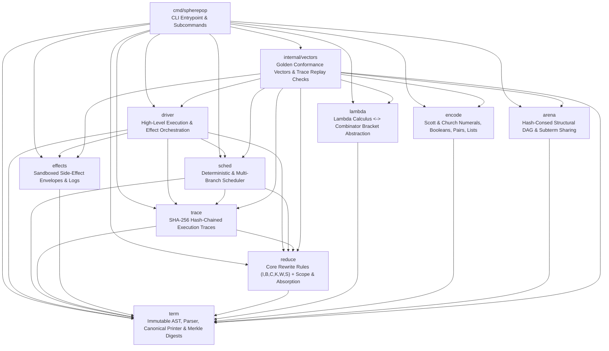
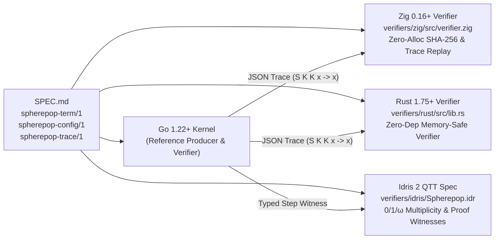

# SpherePOP Kernel — Architecture & Multi-Language Verification Guide

> **Canonical Reference Kernel & Differential Verifier Suite (`Go · Zig · Rust · Idris 2`)**

[`spherepop-kernel`](https://github.com/8b-is/spherepop-kernel) is a small, zero-dependency reference kernel for **circle-calculus term rewriting** (`I, B, C, K, W, S`), **labeled scope brackets** (`<...>_x` / `sc_x`), **configurable absorption regimes**, **hash-chained execution traces**, **multi-branch confluence exploration**, **structural arena sharing**, and **verified side-effect boundaries**.

---

## 1. Downward-Only Dependency Architecture

Every package in the Go kernel obeys a strict downward dependency DAG with zero external module dependencies (`go.mod` requires only the Go standard library):



---

## 2. Four-Language Differential Verification Matrix (`SPEC.md` Fulfilled)

[`SPEC.md`](SPEC.md) explicitly calls for *"a second independent implementation of the verifiers written from the specification"* across `trace`, `effects`, `arena`, and `driver` so that trace integrity and rewrite soundness do not depend on a single compiler or runtime.

This repository ships **four complementary verification lanes**:



| Lane | Path | Role & Guarantees | Test Command |
| :--- | :--- | :--- | :--- |
| **Go (Reference Kernel)** | [`term/`](term/), [`reduce/`](reduce/), [`trace/`](trace/), [`sched/`](sched/), [`driver/`](driver/) | Canonical parser, rewriter, confluence explorer, arena, and CLI | `go test ./...` |
| **Zig (Independent Verifier)** | [`verifiers/zig/src/verifier.zig`](verifiers/zig/src/verifier.zig) | Independent bit-exact implementation of `spherepop-term/1` Merkle digests and `spherepop-trace/1` hash chains | `zig test verifiers/zig/src/verifier.zig` |
| **Rust (Independent Verifier)** | [`verifiers/rust/src/lib.rs`](verifiers/rust/src/lib.rs) | Zero-dependency FIPS 180-4 SHA-256 + `spherepop-term/1` & `spherepop-trace/1` verifier | `cargo test --manifest-path verifiers/rust/Cargo.toml` |
| **Idris 2 (QTT Proof Kernel)** | [`verifiers/idris/Spherepop.idr`](verifiers/idris/Spherepop.idr) | Quantitative Type Theory (`0`, `1`, `ω`) formalization of combinator rules (`K`=erasure, `I`/`B`/`C`=linear, `W`/`S`=shared) and `Step` witnesses | `idris2 --check verifiers/idris/Spherepop.idr` |

---

## 3. Binary Digest & Hash-Chain Specification

### 3.1 Term Merkle Digest (`spherepop-term/1`)

Every `Term` node has a deterministic 32-byte SHA-256 digest computed bottom-up (`term/term.go`):

- **Length-Prefixed Strings (`writeString`)**: Unsigned LEB128 (`uvarint(len(s))`) followed by raw UTF-8 bytes of `s`.
- **Domain Prefix**: `writeString("spherepop-term/1")` = `[0x10]` + `"spherepop-term/1"`.
- **Node Kind Tag (`1 byte`)**:
  - `1` (`KindAtom`): `SHA256(domain || 0x01 || writeString(name))`
  - `2` (`KindConst`): `SHA256(domain || 0x02 || writeString(name))`
  - `3` (`KindScope`): `SHA256(domain || 0x03 || writeString(label))`
  - `4` (`KindApp`): `SHA256(domain || 0x04 || f.Digest[32] || x.Digest[32])`
  - `5` (`KindBracket`): `SHA256(domain || 0x05 || writeString(label) || body.Digest[32])`

### 3.2 Trace Hash Chain (`spherepop-trace/1`)

Execution traces (`trace/trace.go`) use null-delimited SHA-256 domain separation:

```text
sum(p_1, p_2, ..., p_k) = hex(SHA256(p_1 || 0x00 || p_2 || 0x00 || ... || p_k || 0x00))
```

1. **Config Digest**:
   `config_digest = sum("spherepop-config/1", json(config))`
2. **Genesis Digest**:
   `genesis = sum("spherepop-trace/1", start_digest_hex, config_digest)`
3. **Step Link (`i = 0 .. N-1`)**:
   `link_i = sum(prev_link, rule_i, path_i, after_digest_hex_i)`

---

## 4. Rewrite Rules & Confluence Regimes

| Rule | Pattern | Contractum | QTT Multiplicity (`Spherepop.idr`) |
| :--- | :--- | :--- | :--- |
| **`I`** | `I x` | `x` | `1` (Linear identity) |
| **`K`** | `K x y` | `x` | `0` on `y` (Erasure) |
| **`B`** | `B f g x` | `f (g x)` | `1` (Linear composition) |
| **`C`** | `C f x y` | `f y x` | `1` (Linear exchange) |
| **`W`** | `W f x` | `f x x` | `ω` on `x` (Duplication) |
| **`S`** | `S f g x` | `(f x) (g x)` | `ω` on `x` (Shared substitution) |
| **`Sc`** | `sc_a (<x>_a y)` | `<x y>_a` | Scope-Restricted (`any` · `safe` · `settled`) |
| **`Abs`** | `<<x>_a y>_a` | `<x>_a` | Absorption (`off` · `any` · `nf` · `s` · `u`) |
