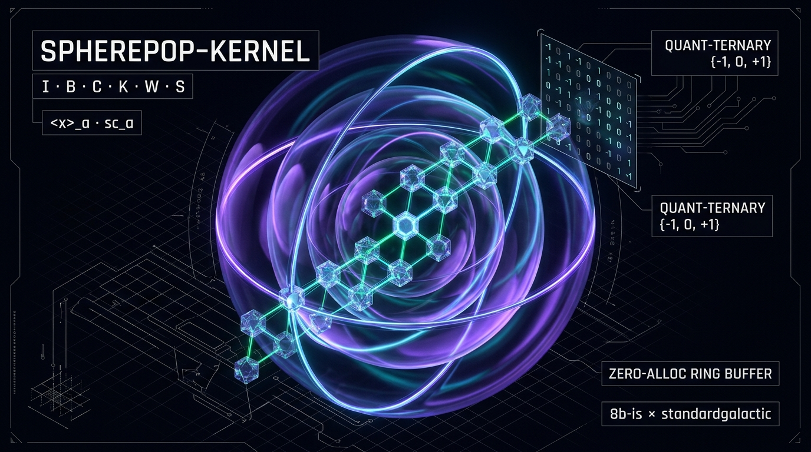

# spherepop-kernel

<p align="center">
  
</p>

<p align="center">
  <em>Built with brotherhood: <strong>peter &lt;3 Nate &bull; 8b-is &lt;3 standardgalactic</strong></em>
</p>

[](https://github.com/8b-is/spherepop-kernel/actions/workflows/ci.yml)
[](https://8b-is.github.io/spherepop-kernel/)
[](ARCHITECTURE.md)
[](SPEC.md)

An independently executable reduction language in Go, built to be hosted inside a game but never to depend on one. The kernel reduces terms of the circle calculus: SK-style combinators extended with brackets and a scope constructor, where the permission to contract a term depends on the chain of brackets around it. Everything runs from the command line with no engine, graphics or network.

The design rests on keeping three things apart. A term is a structural object, a reduction step is an application of an explicit rule that a checker can verify on its own, and a host such as a game entity is only one place a reduction can run. Matching final hashes proves nothing about validity, so every run can emit a trace that an independent check replays step by step against the rule table. Computation, evidence and acceptance are separate objects with separate code.

## Try it

```
go build -o spherepop ./cmd/spherepop

spherepop reduce 'S K K x'                      # x, in 2 steps
spherepop reduce 'S K K x' --out trace.json     # also write a trace document
spherepop check trace.json                      # replay it: "valid: 2 steps, final x"
spherepop compile '\x y. x'                     # K
spherepop sim --entity a='K x y' --entity b='I z' --ticks 2 --budget 5
spherepop rules                                 # the rule table
spherepop test                                  # conformance vectors
```

Reduction takes `--strategy lo|li|ri|ro`, a `--fuel` bound, and the permission configuration flags `--root`, `--perm LABEL=K,C`, `--absorb` and `--sc`. A run that exhausts its fuel exits with status 3 and says so; it never presents a partial term as a result. Exit statuses are 0 for success, 1 for failure, 2 for usage errors and 3 for exhausted fuel.

## What is in it

| Package | Role |
|---|---|
| `term` | Immutable, hash-consed terms, paths, the parser |
| `reduce` | The rule table, permissions, redex finding, strategies, the single authority `Apply` |
| `trace` | Trace documents with a hash chain, and an independent checker |
| `sched` | A deterministic fuel-bounded scheduler and a checker for its log |
| `effects` | The host boundary: typed requests, schema, authorization, an append-only disposition log |
| `encode` | Church-style data that a combinator program can branch on |
| `driver` | Persistent programs: observe, evaluate, extract effects, commit, repeat |
| `lambda` | A front end that compiles `\x y. body` to combinators |
| `arena` | A small headless example world: cells, door-gated portals, ships, host-held memory |
| `cmd/spherepop` | The command line |

The packages depend downward only. `term` knows nothing about reduction, `reduce` knows nothing about hosts, and `arena` is an example host, not part of the language.

## How a game would use it

A program is a term that takes the world's observations as arguments and reduces to a normal form listing the effects it proposes, for example `effects (effect (door 1) open)`. Effects are inert data during reduction. Only after a normal form does the host read them, check each one against a schema and an authorizer, apply the ones that pass, and record a disposition for every one, including refusals. Three relations stay distinct: reduction of the term, extraction of effects from the normal form, and the host's transition on the world. The scheduler's only powers are ordering entities deterministically, giving each a fixed step budget, and continuing unfinished terms, and its log separates its own decisions from reduction steps. `SPEC.md` section 14 onward describes this in full, and `arena/arena_test.go` runs a behavior written in lambda syntax through a door to a goal cell.

## Status of the mathematics

The reducer implements the combinators with permission-gated contraction and two boundary rules, absorption (`Abs`) and scope (`Sc`). Their side conditions decide whether the system is confluent, and the repository is explicit about which claims are proved and which are not.

With `--absorb s --sc settled`, where both boundary rules fire only on arguments that contain no steps at all, confluence is proved for every permission structure, non-terminating terms included. The proof is `notes/settled-scope.tex`, and a bounded search of tens of millions of parallel-reduction pairs agrees with it. The `safe` scope mode, which the scheduler uses by default, is not proved. The proof route fails at one identified pattern, `sc_x (<I>_x a)`, and local confluence of the full relation still held in every case searched, so it is unrefuted and unproven. The reducer's default `--absorb u` is likewise outside the theorem. The essay's unrestricted `Sc` is available as `--sc any` and is a research mode: it is known to be non-confluent when a label restricts the root permission.

## Tests

`go test ./...` takes about a minute. Longer exhaustive searches, which enumerate every term up to a size bound and every permission assignment, are enabled by environment variables: `SPHEREPOP_SEARCH_LEAVES`, `SPHEREPOP_SEARCH_BRACKETS` and `SPHEREPOP_SEARCH_LABELS=2`. The largest reported runs take around twenty minutes. Each search has a positive control that must find a known failure, so a passing search cannot be an empty one.

## Not done

Suspension points inside a round, atomic transactions, a command-line entry for the driver and the arena, and a second independent implementation of the verifiers written from the specification. A proof for the `safe` and `u` modes is open.

## Specification

`SPEC.md` defines the term syntax and digests, the rules, permissions, absorption and scope modes, strategies, fuel, trace and log formats, the effects boundary and the frame loop. Where the specification and the code disagree, that is a bug in one of them.

---

## Multi-Language Independent Verifiers (`Go · Zig · Rust · Idris 2`)

To fulfill the independent-verifier requirement in [`SPEC.md`](SPEC.md), [`verifiers/`](verifiers/) provides bit-exact independent implementations of the `spherepop-term/1` Merkle digests, `spherepop-config/1` hashes, `spherepop-trace/1` hash chains, and Quantitative Type Theory (`0, 1, ω`) rewrite witnesses:

```bash
# 1. Go reference kernel & conformance vectors
go test ./...

# 2. Zig independent digest & trace-chain verifier
zig test verifiers/zig/src/verifier.zig

# 3. Rust zero-dependency digest & trace-chain verifier
cargo test --manifest-path verifiers/rust/Cargo.toml

# 4. Idris 2 QTT (0, 1, ω) combinator & proof-witness module
idris2 --check verifiers/idris/Spherepop.idr
```

---

## Performance & Concurrency Extensions (`8b-is × standardgalactic`)

Without altering any rule semantics or digest bytes in [`SPEC.md`](SPEC.md), the kernel includes zero-allocation hot-path optimizations, concurrent worker-pool scheduling, a 16-state capability-graph engine, and a lossless balanced-ternary (`{-1, 0, +1}`) wire format:

| Subsystem | Location | Optimization & Capability |
| :--- | :--- | :--- |
| **Zero-Alloc Merkle Hashing & Bitmask Flags** | [`term/term.go`](term/term.go), [`reduce/find.go`](reduce/find.go) | Stack-buffered `sha256.Sum256` (`[82]byte` for `App`) + 8-bit monotonic capability bitmask (`t.Flags()`), turning `isInsensitive(v)` and pure-atom `isRNormal`/`isSettled` checks into `0.3 ns` (`0 allocs/op`) 1-cycle bitwise ANDs |
| **16-State Bit-Parallel Capability Graph** | [`reduce/capgraph.go`](reduce/capgraph.go) | Compiles `Config.Perm` into a 32-byte `[16]uint16` Warshall bitmatrix closure over $2^{\{W,K,C,S\}}$ with hardware `POPCNT` / `CTZ` reachability (`BuildCapGraph`, `CanReach`, `IsMonotone`) |
| **Cache-Line-Padded Ring Buffer & Parallel Scheduler** | [`reduce/capgraph.go`](reduce/capgraph.go), [`sched/parallel.go`](sched/parallel.go) | Lock-free power-of-two MPMC `RingBuffer[T]` (`[64]byte` false-sharing padding) feeding `Config.ReduceBatchParallel` and `World.TickParallel` / `World.RunParallel` with bit-identical `sched.CheckLog` output |
| **`quantTernary` (`SPQT`) Lossless Codec** | [`encode/ternary.go`](encode/ternary.go) | Balanced ternary `Trit ∈ {-1, 0, +1}` Polish-prefix AST stream (`App` = 2 trits, `I,B,C,K,W,S` = 4 trits) packed at **5 trits/byte** (`base-243`, `1.585 bits/trit`) + 64-trit dual-bitplane `TritWord64` hardware `POPCNT` dot products |

See [`ARCHITECTURE.md`](ARCHITECTURE.md) for the full dependency graph and binary digest wire format, or open the **[Interactive WebCrypto Evaluator & Trace Verifier](https://8b-is.github.io/spherepop-kernel/)**.
